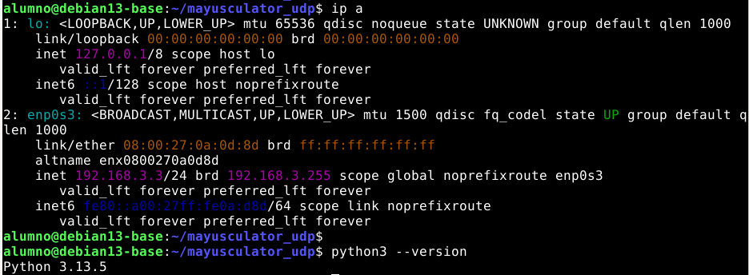
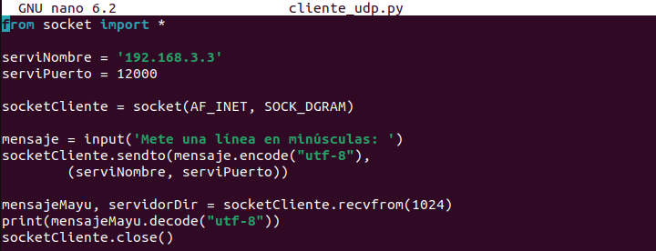
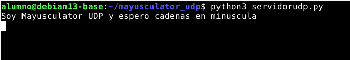
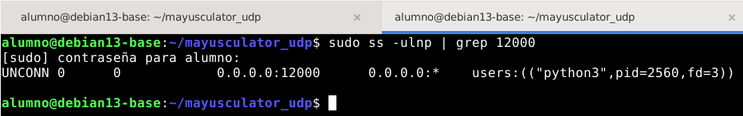
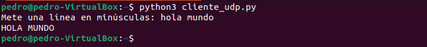
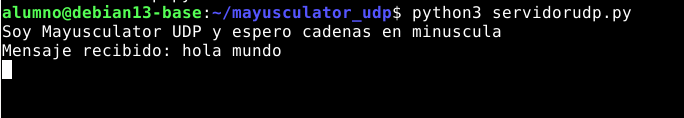

# Mayusculator UDP - Python 3


## Descripción

Aplicación cliente-servidor que envía un texto mediante UDP y devuelve el mismo texto en mayúsculas. Práctica de Sistemas de Redes e Internet (SRI).

## Entorno de trabajo

| Característica | Configuración prevista |
|---|---|
| Servidor | Debian |
| Cliente | Ubuntu |
| IP del servidor | 192.168.3.3/24 |
| Puerto | 12000/UDP |
| Lenguaje | Python 3 |

## Código fuente

- [Servidor UDP](codigo/servidorudp.py)
- [Cliente UDP](codigo/clienteudp.py)

## Funcionamiento

El servidor utiliza `SOCK_DGRAM`, recibe datagramas con `recvfrom()`, transforma el mensaje mediante `upper()` y responde con `sendto()`. El cliente envía una cadena codificada en UTF-8 y espera la respuesta. UDP no garantiza entrega ni orden.

## Ejecución

No se necesitan librerías externas. Desde la raíz del repositorio, en Debian:

```bash
python3 codigo/servidorudp.py
```

En Ubuntu:

```bash
python3 codigo/clienteudp.py
```

Ejemplo esperado: `hola mundo` → `HOLA MUNDO`.

Para comprobar el puerto en Debian:

```bash
sudo ss -ulnp | grep ':12000'
```

## Capturas de la práctica

Añadir las imágenes reales en `codigo/imagenes/` con los nombres indicados. Hasta entonces los enlaces no mostrarán las imágenes.

### 1. Dirección IP del servidor



### 2. Conectividad desde Ubuntu



### 3. Inicio del servidor UDP



### 4. Puerto UDP



### 5. Envío y respuesta en el cliente



### 6. Recepción en el servidor



## Documentación

La memoria definitiva se podrá consultar en la carpeta `documentacion/` una vez completada y subida al repositorio.

## Referencias

- [Documentación de sockets de Python](https://docs.python.org/es/3/library/socket.html)
- [RFC 768 - UDP](https://www.rfc-editor.org/rfc/rfc768)

## Autores

- KarmaVS
- pedro-hg07

---
Proyecto académico - Sistemas de Redes e Internet (SRI)

